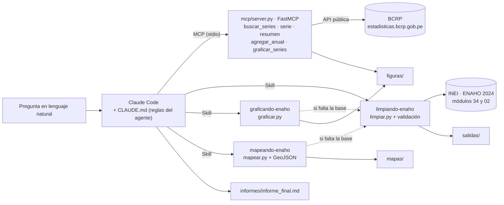
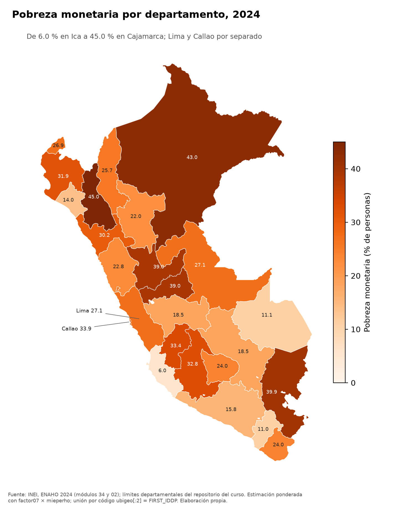

# Tarea 4 · Agente de investigación socioeconómica: MCP del BCRP + Skills de la ENAHO 2024

**Curso:** Python Intermedio · **Estudiante:** Lory Acosta Carbajal ([@loryac21-cyber](https://github.com/loryac21-cyber))
· **Enunciado:** [issue #201](https://github.com/d2cml-ai/Data-Science-Python/issues/201)

> **Pregunta de investigación:** Entre 2019 y 2024, ¿cómo evolucionaron la actividad agropecuaria y los precios de
> los alimentos en el Perú, y qué tan grande era en 2024 la brecha de pobreza monetaria entre el área rural y la
> urbana y entre departamentos?

**Informe final:** [`informes/informe_final.md`](informes/informe_final.md) · **Verificación de cifras:**
[`informes/verificacion_cifras.md`](informes/verificacion_cifras.md) · **Evaluación:**
[`evaluacion/comparacion.md`](evaluacion/comparacion.md)

| Resultado | Valor |
|---|---|
| Pruebas del MCP | **11/11** (las 8 originales del curso sin cambios + 3 propias) |
| Pobreza nacional 2024 | **27.58 %** (hogares, `factor07 × mieperho`) · 27.53 % (personas, `facpob07`) · referencia 27.6 % |
| Residentes habituales | **108,664** |
| Unidades territoriales | **25/25**, las 25 iguales a la referencia de la sesión 16 (±0.05 pp) |
| Evaluación | Sin MCP/Skills: **0/10** (10 «no sé») · Con MCP/Skills: **10/10** |

## 1. Objetivo

Construir un agente en Claude Code que responda preguntas sobre la economía y la pobreza del Perú **con herramientas,
no de memoria**: consulta series oficiales del BCRP por MCP, procesa los microdatos de la ENAHO 2024 con Skills que
validan cada paso, produce gráficos y mapas, y escribe un informe donde cada cifra se puede rastrear hasta su fuente.
Elegí un tema cercano a mi trabajo en el sector agrario: la actividad agropecuaria y los precios de los alimentos
frente a la pobreza rural y departamental.

## 2. Arquitectura del agente



- **`CLAUDE.md`** convierte a Claude Code en el agente: ninguna cifra de memoria, cita de fuente en cada número,
  ENAHO siempre ponderada, asociación no es causa y el flujo plan → BCRP → ENAHO → informe.
- **`.mcp.json`** conecta el servidor `bcrp` (`uv run mcp/server.py`).
- **`.claude/skills/`** tiene las tres skills; Claude Code las carga solas cuando el pedido coincide con su
  `description`, o a mano con `/limpiando-enaho`.
- **`agente/`** corre el agente sin intervención (`claude -p`) y guarda la transcripción completa de cada ejecución.

## 3. Servidor MCP del BCRP (`mcp/server.py`)

Basado en el proyecto de la sesión 04 (FastMCP 4) y en mi servidor de la clase 7. Las cuentas se hacen en Python y
cada respuesta trae la URL de la API del BCRP de donde salió.

| Primitiva | Nombre | Qué hace |
|---|---|---|
| Herramienta | `buscar_series` | Busca entre las ~17 mil series del catálogo por palabras clave y frecuencia |
| Herramienta | `serie` | Baja los datos de una serie entre dos fechas (diaria, mensual, trimestral o anual) |
| Herramienta | `resumen` | Primero, último, cambio, variación %, promedio, máximo y mínimo |
| **Herramienta propia** | **`agregar_anual`** | Lleva una serie mensual, trimestral o diaria a **años** (promedio, suma, fin de año, inicio, máximo, mínimo), con la variación frente al año anterior y **marca los años incompletos** en vez de compararlos. Es el puente con la ENAHO, que es anual |
| **Herramienta propia** | **`graficar_series`** | Grafica hasta 4 series de la misma frecuencia y guarda el PNG en `figuras/` con título, unidad y fuente con los códigos |
| Herramienta | `comparar_paises` | Contexto internacional con el Banco Mundial (de la clase 7) |
| Recurso | `bcrp://serie/{codigo}` | Ficha de una serie: nombre, frecuencia, inicio, última actualización |
| Recurso | `bcrp://series-clave` | Los códigos que usa el proyecto (inflación, alimentos, PBI agropecuario, exportaciones) |
| Prompt | `informe(tema)` | Informe de 5 viñetas con cada cifra verificable |
| Prompt | `investigacion(pregunta)` | El flujo completo BCRP + ENAHO que termina en `informes/informe_final.md` |

**Pruebas (`mcp/test_server.py`): 11 passed.** Las 8 primeras son las del curso, copiadas sin cambios (el archivo
original y este coinciden línea por línea hasta `test_un_prompt`). Las 3 propias comparan contra otra publicación
oficial, no contra cifras escritas a mano:

| Prueba propia | Qué comprueba |
|---|---|
| `test_agregar_anual_suma_coincide_con_la_serie_anual_oficial` | La suma de los 12 meses de exportaciones (PN38714BM) da lo mismo que la serie anual del BCRP (PM40027BA) en 2022, 2023 y 2024 |
| `test_agregar_anual_avisa_anios_incompletos_y_no_inventa` | «fin» devuelve el dato de diciembre; 2026 sale como incompleto; una serie anual o una operación inválida dan error |
| `test_graficar_series_guarda_el_png_con_su_fuente` | Se guarda el PNG con las URL de las fuentes; series de distinta frecuencia dan error |

## 4. Las tres Skills de la ENAHO (`.claude/skills/`)

| Skill | Entra | Hace | Sale |
|---|---|---|---|
| [`limpiando-enaho`](.claude/skills/limpiando-enaho/SKILL.md) | Zips de los módulos 34 y 02 | Lee los `.dta` con las llaves como texto, normaliza nombres (`aÑo` → `anio`), filtra residentes habituales `((p204==1)&(p205==2))\|((p204==2)&(p206==1))`, une con `merge(validate="m:1")`, construye departamento (`ubigeo[:2]`), área (`estrato <= 5`), pobreza, sexo y edad, **valida 17 puntos** y se detiene si falla uno esencial | `salidas/validacion.txt`, `salidas/indicadores.csv`, `salidas/hogares_2024.parquet`, `salidas/personas_2024.parquet` |
| [`graficando-enaho`](.claude/skills/graficando-enaho/SKILL.md) | La base limpia | Gráficos ponderados por área, región natural, sexo, edad, departamento y dónde viven los pobres; barras desde cero, valor escrito, promedio nacional, título analítico, unidad y fuente | `figuras/enaho_*.png` y un CSV con las cifras de cada gráfico |
| [`mapeando-enaho`](.claude/skills/mapeando-enaho/SKILL.md) | La base limpia y el GeoJSON del curso | Une **por código** `ubigeo[:2]` = `FIRST_IDDP` con `validate="1:1"`, exige 25 unidades con dato (Lima y Callao separados), colores de claro a oscuro desde 0 y compara cada departamento con la referencia de la sesión 16 | `mapas/pobreza_departamento_2024.png`, `salidas/comparacion_mapa_referencia.csv` |

La validación (`salidas/validacion.txt`) aprueba 17 de 17: 33,691 hogares, 117,721 filas del módulo 02, llaves
únicas y con ceros, **108,664 residentes**, unión m:1 sin perder ni duplicar personas, **25 códigos territoriales**,
factores positivos, **pobreza nacional 27.58 %** (±0.1 pp de 27.6 %), extrema 5.50 %, urbana 24.81 %, rural 39.30 %,
Lima Metropolitana 28.21 %, y la prueba de que se pondera (el promedio simple daría 25.61 %).

**Activación y coordinación** ([`evidencias_ia/skills/`](evidencias_ia/skills/)): `/limpiando-enaho 2024` la
invoca a mano; «Grafica la pobreza … por sexo y por grupo de edad» activa `graficando-enaho` sola; y «Haz un mapa de
la pobreza monetaria por departamento con ENAHO 2024», **sin la base procesada**, activó `mapeando-enaho`, que vio
que faltaba la base, activó `limpiando-enaho`, revisó `ESTADO: OK` y recién entonces hizo el mapa.

## 5. Fuentes y descarga de datos

| Fuente | Datos | Enlace | Dónde queda |
|---|---|---|---|
| INEI | ENAHO 2024, módulo 34 (sumaria) | [966-Modulo34.zip](https://proyectos.inei.gob.pe/iinei/srienaho/descarga/STATA/966-Modulo34.zip) | `datos/enaho/` |
| INEI | ENAHO 2024, módulo 02 (miembros del hogar) | [966-Modulo02.zip](https://proyectos.inei.gob.pe/iinei/srienaho/descarga/STATA/966-Modulo02.zip) | `datos/enaho/` |
| Curso | Límites departamentales | [peru_departamental_simple.geojson](https://raw.githubusercontent.com/d2cml-ai/Data-Science-Python/main/sessions/06-geoespacial/lab/Data/peru_departamental_simple.geojson) | `datos/geo/` |
| BCRP | Series estadísticas y catálogo | [estadisticas.bcrp.gob.pe](https://estadisticas.bcrp.gob.pe/estadisticas/series/) | API en vivo; catálogo en `datos/bcrp/` |

`datos/` no se sube (`.gitignore`): `limpiar.py --descargar` baja los zip del INEI, `mapear.py` baja el GeoJSON y el
servidor baja el catálogo la primera vez. Si el INEI no responde, bájenlos con el navegador a `datos/enaho/`.
Detalle en [`datos/LEEME.md`](datos/LEEME.md).

## 6. Instalación con `uv`

Se necesita [uv](https://docs.astral.sh/uv/), [Claude Code](https://code.claude.com) con la sesión iniciada e
internet. Python 3.14 (lo instala `uv`).

```bash
git clone https://github.com/loryac21-cyber/tarea-4.git
cd tarea-4
uv sync                  # crea .venv con fastmcp, pandas, pyarrow, geopandas, matplotlib, pytest
```

En VS Code: abrir la carpeta y elegir el intérprete `.venv` (ya está en `.vscode/settings.json`); las pruebas
aparecen en la pestaña *Testing*.

## 7. Conectar el MCP a Claude Code

El repositorio ya trae `.mcp.json`. Al abrir `claude` en la carpeta, aceptar el servidor `bcrp` cuando lo pregunte, y
revisar con `/mcp` que esté conectado con sus 6 herramientas. Para crearlo desde cero:

```bash
claude mcp add --scope project bcrp -- uv run mcp/server.py
```

Para probar: `@bcrp:bcrp://serie/PN09822PM ¿desde cuándo hay datos?`, `/mcp__bcrp__informe inflación de alimentos`
o `/mcp__bcrp__investigacion <pregunta>`.

## 8. Reproducir el procesamiento, las pruebas y el agente

```bash
uv run pytest -v                                                  # 11 pruebas del MCP (datos reales del BCRP)
uv run .claude/skills/limpiando-enaho/scripts/limpiar.py --descargar   # ENAHO: bases, indicadores y validación
uv run .claude/skills/graficando-enaho/scripts/graficar.py --tipo todos
uv run .claude/skills/mapeando-enaho/scripts/mapear.py
uv run agente/ejecutar_agente.py          # la investigación completa con claude -p (borra y regenera salidas)
uv run agente/demo_skills.py              # activación y encadenamiento de las skills
uv run evaluacion/verificar_verdades.py   # respuestas esperadas del BCRP, sin el MCP
uv run evaluacion/evaluar.py              # el experimento: 10 preguntas × 2 modos
uv run informes/verificar_cifras.py       # recálculo independiente de 7 cifras del informe
```

## 9. Resultados de la evaluación

10 preguntas (4 del BCRP, 4 de la ENAHO y 2 combinadas) con respuestas esperadas fijadas antes y comprobadas fuera
del agente, cada una en una sesión nueva de `claude -p` con Sonnet. Análisis completo en
[`evaluacion/comparacion.md`](evaluacion/comparacion.md); datos en
[`evaluacion/resultados.csv`](evaluacion/resultados.csv).

| Modo | Correctas | Incorrectas | No sabe | Segundos promedio | Turnos |
|---|---:|---:|---:|---:|---:|
| A · sin MCP ni Skills (sin herramientas, carpeta vacía) | 0 | 0 | 10 | 6.9 | 2.0 |
| B · con MCP y Skills (copia del proyecto sin respuestas ni salidas) | **10** | 0 | 0 | 24.7 | 7.0 |
| Extra: A sin permiso para decir «no sé» | 0 | **3** | 5 (+2 parciales) | 9.0 | 2.0 |

- **Sin herramientas** el modelo no tiene las cifras y dice «no sé»; si se le quita esa salida, **inventa** cifras con
  citas creíbles (PBI agropecuario 2024 = 3.6 % en vez de 5.57 %; pobreza rural 39.8 % en vez de 39.3 %).
- **Con herramientas** acierta las 10 con su código de serie o archivo: las del BCRP con `buscar_series` + `serie`,
  `resumen` o `agregar_anual`; las de la ENAHO corriendo `limpiar.py` desde los zip del INEI; las combinadas con 2
  herramientas MCP y una skill en la misma sesión. Las 10 preguntas mejoraron y ninguna empeoró.
- **Lo que no salió perfecto:** en una primera corrida, con resultados ya calculados, el agente leyó
  `salidas/indicadores.csv` en vez de activar las skills (por eso se repitió desde datos crudos), y en 2 de 6
  preguntas de la ENAHO corrió el script de la skill tras leer su `SKILL.md`, sin pasar por la herramienta `Skill`.

## 10. Limitaciones y problemas encontrados

**Del análisis.** La ENAHO aporta un solo corte (2024), así que no hay una serie de pobreza para comparar año a año
con las series del BCRP; las series son nacionales y la inflación es de Lima Metropolitana; el área rural no equivale
a «hogares agropecuarios» (los módulos 34 y 02 no dicen en qué trabajan las personas); las estimaciones son
muestrales y no se calcularon intervalos de confianza. Todo se presenta como asociación descriptiva, no causal.

**Del desarrollo** (y cómo se resolvieron):

| Problema | Solución |
|---|---|
| La columna del año llega como `aÑo` y a veces se lee `a�o` | `normalizar_columnas` la renombra a `anio` |
| La API del BCRP responde HTML cuando recibe muchos pedidos seguidos | Reintentos con espera y caché en el servidor y en los scripts de verificación |
| En Windows, Claude Code ejecuta comandos con PowerShell, no Bash | Los permisos se dan para los dos: `PowerShell(uv run:*)` y `Bash(uv run:*)` |
| En la primera corrida de la evaluación, el modo con herramientas leyó `salidas/indicadores.csv` ya calculado en vez de activar las skills | Se repitió con una copia del proyecto por pregunta, sin `salidas/`; la primera corrida se conserva como variante documentada |
| Faltaba `tabulate` para escribir las tablas en Markdown | `uv add tabulate` y la opción `--solo-resumen` para rehacer el resumen sin repetir las 20 llamadas |
| Títulos largos que se montaban sobre el subtítulo en los gráficos | Título con `suptitle` y salto de línea automático |
| No se creó `.claude/settings.json` del proyecto (la herramienta lo bloqueó por ser configuración del propio agente) | Los permisos se pasan por línea de comandos en `agente/registro.py`; en uso interactivo, Claude Code pide aprobar cada herramienta |

## 11. Ejemplo de una ejecución completa

`uv run agente/ejecutar_agente.py` borró `salidas/`, `figuras/` y `mapas/` y lanzó `claude -p` (Sonnet) con la
pregunta. En **93 segundos y 26 turnos** el agente
([transcripción](evidencias_ia/integracion/ejecucion_20261108_0002.md)):

1. Escribió un plan: series del BCRP para PBI agropecuario e inflación de alimentos; pobreza 2024 por área y
   departamento de la ENAHO.
2. Usó el MCP: `buscar_series` (encontró PN01755AM, PN01713AM y PN09822PM), `agregar_anual` (promedios anuales e
   inflación a diciembre), `resumen` (máximo y mínimo) y `graficar_series` (`figuras/bcrp_agro_alimentos.png`).
3. Usó las skills: `limpiando-enaho` (17/17 verificaciones), `graficando-enaho` (área, distribución de pobres,
   departamentos) y `mapeando-enaho` (25/25 departamentos iguales a la referencia).
4. Escribió [`informes/informe_final.md`](informes/informe_final.md) con 4 hallazgos, el gráfico del BCRP, tres de la
   ENAHO, el mapa, interpretación, limitaciones y reproducibilidad.



**Hallazgos principales:** el PBI agropecuario cayó 2.04 % en 2023 y creció 5.57 % en 2024; la inflación de
alimentos de Lima promedió 10.78 % en 2022 y bajó a 2.01 % en 2024; en 2024 la pobreza rural (39.30 %) superó en 14.5
puntos a la urbana (24.81 %), aunque el 72.7 % de las personas pobres vivía en zonas urbanas; y entre departamentos
fue de 6.01 % en Ica a 45.01 % en Cajamarca. Siete de estas cifras se comprobaron por un camino independiente en
[`informes/verificacion_cifras.md`](informes/verificacion_cifras.md).

## 12. Evidencias del uso de inteligencia artificial

En [`evidencias_ia/`](evidencias_ia/): la transcripción completa de cada ejecución del agente (`.jsonl` + `.md`): integración, activación de skills y las 50 sesiones de la
evaluación (20 principales, 20 de la variante con salidas previas y 10 del experimento sin «no sé»). Usé **Claude Code** para leer el enunciado y los materiales de las sesiones 04 y 16, escribir el servidor,
las pruebas propias, las skills, los scripts del agente y de la evaluación, y para revisar los resultados. Revisé y
verifiqué las cifras contra la web del BCRP, el informe del INEI y la referencia de la sesión 16.

## Estructura

```
tarea-4/
├── README.md · CLAUDE.md · .mcp.json · pyproject.toml · uv.lock · .gitignore · .python-version
├── mcp/                 server.py, test_server.py (8 originales + 3 propias)
├── .claude/skills/      limpiando-enaho/ · graficando-enaho/ · mapeando-enaho/ (SKILL.md, scripts/, referencias)
├── agente/              registro.py, ejecutar_agente.py, demo_skills.py
├── datos/               LEEME.md (los datos originales se bajan; git los ignora)
├── salidas/             validacion.txt, indicadores.csv, comparacion_mapa_referencia.csv
├── figuras/  mapas/     PNG con su CSV de cifras
├── evaluacion/          preguntas.csv, evaluar.py, verificar_verdades.py, resultados*.csv, resumen*.md, comparacion.md
├── informes/            informe_final.md, verificacion_cifras.md/.csv, verificar_cifras.py
└── evidencias_ia/       mcp/, skills/, integracion/, evaluacion/
```
