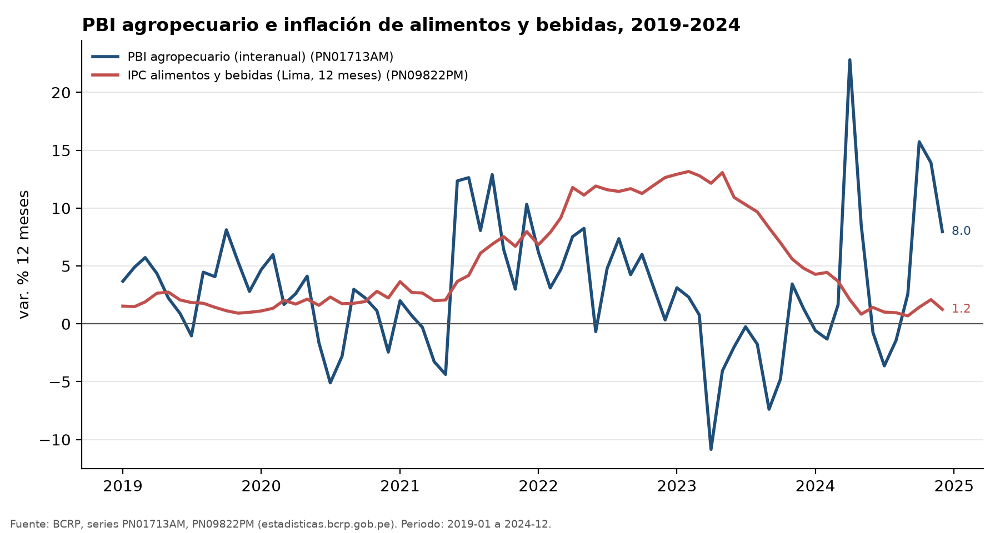
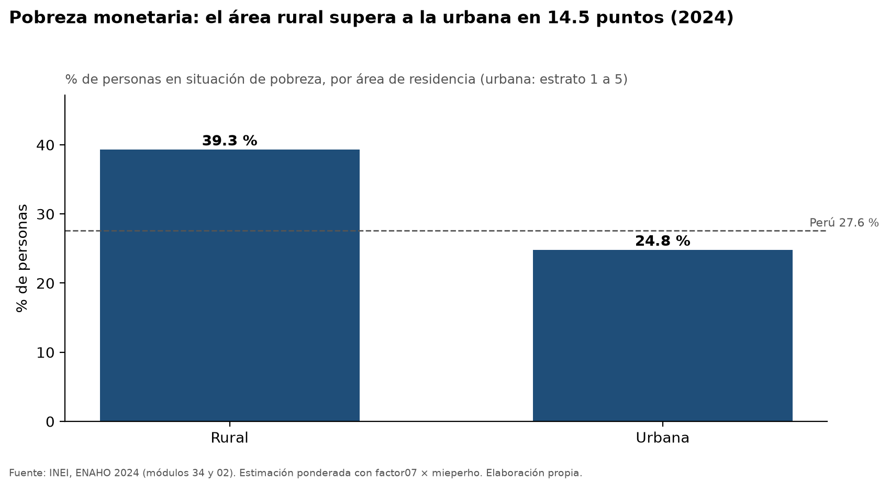
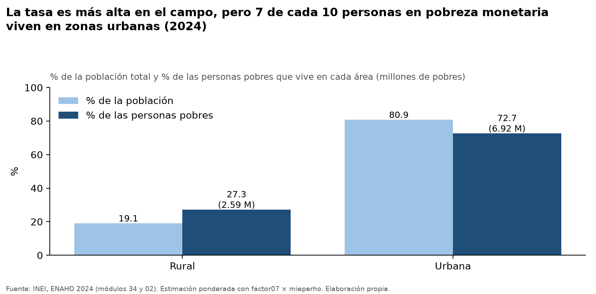
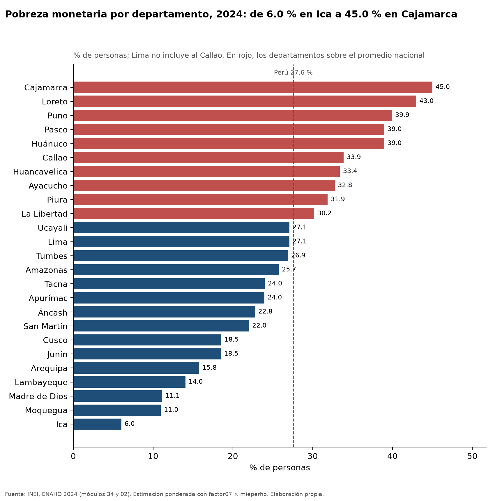
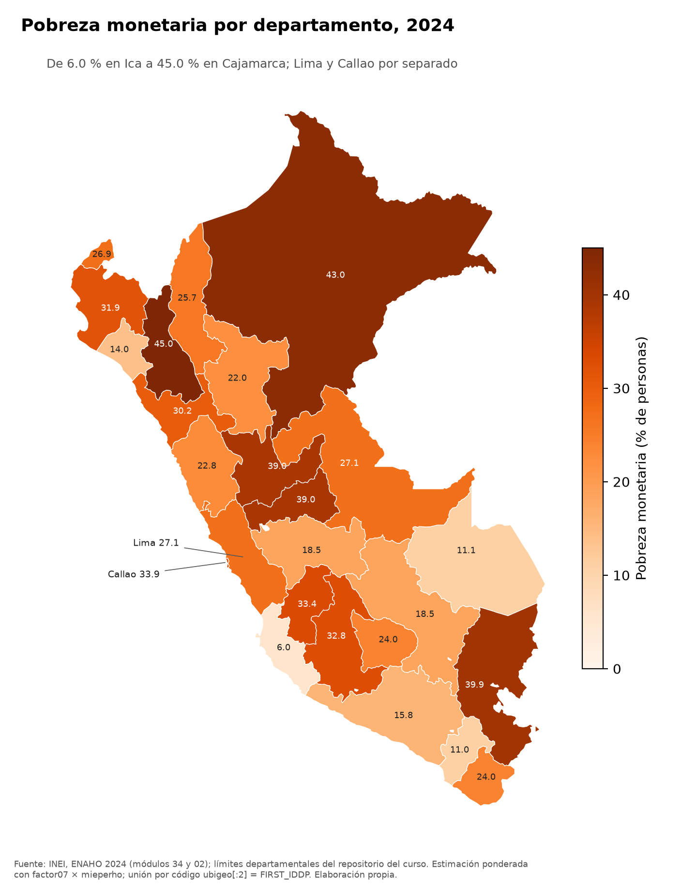

# Actividad agropecuaria, precios de alimentos y pobreza monetaria en el Perú (2019-2024)

## 1. Pregunta de investigación

**Tema.** Evolución de la actividad agropecuaria y de los precios de los alimentos, y desigualdad territorial de la pobreza monetaria.

**Pregunta.** Entre 2019 y 2024, ¿cómo evolucionaron la actividad agropecuaria y los precios de los alimentos en el Perú, y qué tan grande era en 2024 la brecha de pobreza monetaria entre el área rural y la urbana y entre departamentos?

**Objetivo.** Describir (1) la trayectoria anual 2019-2024 del PBI agropecuario y de la inflación de alimentos y bebidas, y (2) la pobreza monetaria de 2024 por área y por departamento.

**Delimitación.** El BCRP aporta series nacionales (la inflación es de Lima Metropolitana) de 2019 a 2024. La ENAHO aporta un solo corte, 2024. Las dos fuentes se presentan como contexto; el informe no establece relación causal entre ellas.

## 2. Fuentes y metodología

| Fuente | Datos | Método |
|---|---|---|
| BCRP, series estadísticas (MCP `bcrp`) | PN01755AM (PBI agropecuario, índice 2007=100), PN01713AM (PBI agropecuario, var. % interanual), PN09822PM (IPC Alimentos y Bebidas, Lima Metropolitana, var. % 12 meses) | `agregar_anual` (promedio anual y valor a diciembre), `resumen` (extremos), `graficar_series` |
| INEI, ENAHO 2024, módulos 34 (sumaria) y 02 (miembros del hogar) | Pobreza monetaria por área, departamento y distribución de las personas pobres | Skills `limpiando-enaho`, `graficando-enaho`, `mapeando-enaho`. Hogares ponderados con `factor07 × mieperho`. Área urbana = estrato ≤ 5, rural = estrato ≥ 6. |

La validación de la ENAHO (`salidas/validacion.txt`) terminó en **ESTADO: OK, 17 de 17 verificaciones aprobadas**. Incluye pobreza nacional de 27.58 % en hogares ponderados y 27.53 % en personas con `facpob07` (referencia 27.6 %). El promedio simple sin factor da 25.61 %, lo que confirma que la base se pondera.

## 3. Resultados

### Hallazgo 1. La actividad agropecuaria creció en 2024, tras una caída en 2023

Promedio anual del índice del PBI agropecuario (PN01755AM, 2007=100; BCRP, `agregar_anual`, operación promedio):

| Año | Índice | Var. % anual |
|---|---|---|
| 2019 | 163.40 | — |
| 2020 | 165.08 | 1.03 |
| 2021 | 172.75 | 4.64 |
| 2022 | 180.61 | 4.55 |
| 2023 | 176.92 | -2.04 |
| 2024 | 186.78 | 5.57 |

La serie mensual interanual (PN01713AM) osciló entre un mínimo de -10.84 % en 2023-04 y un máximo de 22.81 % en 2024-04. Su promedio mensual 2019-2024 fue 3.05 %.
Fuente: https://estadisticas.bcrp.gob.pe/estadisticas/series/api/PN01755AM/json/2019-1/2024-12 y https://estadisticas.bcrp.gob.pe/estadisticas/series/api/PN01713AM/json/2019-1/2024-12.

### Hallazgo 2. La inflación de alimentos subió hasta 2022-2023 y bajó en 2024

IPC Alimentos y Bebidas, Lima Metropolitana, var. % a 12 meses (PN09822PM; BCRP, `agregar_anual`):

| Año | Promedio anual (%) | A diciembre (%) |
|---|---|---|
| 2019 | 1.71 | 1.00 |
| 2020 | 1.89 | 2.24 |
| 2021 | 4.68 | 7.97 |
| 2022 | 10.78 | 12.64 |
| 2023 | 10.06 | 4.80 |
| 2024 | 2.01 | 1.25 |

El máximo mensual fue 13.16 % en 2023-02 y el mínimo 0.69 % en 2024-09 (BCRP, `resumen`).
Fuente: https://estadisticas.bcrp.gob.pe/estadisticas/series/api/PN09822PM/json/2019-1/2024-12.

### Hallazgo 3. En 2024 la pobreza rural superó a la urbana, pero la mayoría de las personas pobres vivía en zonas urbanas

Pobreza monetaria 2024 (INEI, ENAHO 2024, ponderado con `factor07 × mieperho`; `figuras/enaho_pobreza_area_2024.csv`):

- Rural: 39.30 % (n = 11,660 hogares).
- Urbana: 24.81 % (n = 22,031 hogares).
- La brecha es de 14.49 pp, diferencia entre las dos cifras anteriores.

Distribución de las personas pobres (`figuras/enaho_distribucion_pobres_area_2024.csv`):

- Urbana: 72.74 % de las personas pobres (6.92 millones), con 80.87 % de la población.
- Rural: 27.26 % (2.59 millones), con 19.13 % de la población.

### Hallazgo 4. La brecha entre departamentos es mayor que la brecha rural-urbana

Pobreza monetaria 2024 por departamento (INEI, ENAHO 2024, ponderado con `factor07 × mieperho`; `mapas/pobreza_departamento_2024.csv`):

- Más alta: Cajamarca 45.01 %, Loreto 42.97 %, Puno 39.94 %, Pasco 38.97 %, Huánuco 38.96 %.
- Más baja: Ica 6.01 %, Moquegua 10.97 %, Madre de Dios 11.15 %, Lambayeque 14.04 %, Arequipa 15.78 %.
- Lima 27.07 % y Callao 33.86 %, tomados por separado.
- Entre Cajamarca e Ica hay 39.00 pp de diferencia, calculada con las dos cifras anteriores.

Comparación con la referencia de la sesión 16: 25 de 25 departamentos coinciden (±0.1 pp); la diferencia máxima es 0.049 pp (`salidas/comparacion_mapa_referencia.csv`).

## 4. Visualizaciones

**Gráfico BCRP.** PBI agropecuario e inflación de alimentos, 2019-2024 (PN01713AM y PN09822PM).



**Gráfico ENAHO.** Pobreza monetaria 2024, urbano y rural.



**Gráfico ENAHO.** Distribución de las personas pobres por área.



**Gráfico ENAHO.** Pobreza monetaria por departamento.



**Mapa.** Pobreza monetaria por departamento, 2024.



## 5. Interpretación

- La actividad agropecuaria creció en cuatro de las cinco variaciones anuales (2020, 2021, 2022 y 2024), con una caída en 2023. En 2024 el índice anual fue 186.78, el más alto del periodo.
- La inflación de alimentos tuvo su pico en 2022-2023 y volvió a niveles bajos en 2024 (2.01 % de promedio anual).
- La pobreza de 2024 se concentra, en tasa, en el campo y en ciertos departamentos (Cajamarca, Loreto, Puno). En número de personas, la mayoría de las personas pobres vive en áreas urbanas, por el peso de la población urbana.
- Las series del BCRP son nacionales y la inflación es de Lima Metropolitana. La ENAHO es un corte de 2024. Se muestran juntas como contexto, **sin afirmar que una explique a la otra**: con un solo año de pobreza no se puede ver cómo cambió con la inflación o con la producción agropecuaria.

## 6. Limitaciones

- La ENAHO se usa solo para 2024, así que no hay serie de pobreza 2019-2024 comparable con las series del BCRP.
- El PBI agropecuario es nacional y la inflación de alimentos es de Lima Metropolitana; no reflejan los precios que enfrentan los hogares rurales ni los departamentos.
- Los resultados son estimaciones muestrales y no se calcularon intervalos de confianza. Todos los grupos mostrados superan los 300 casos muestrales (el menor departamento es Madre de Dios, con 603 hogares).
- La definición de área urbana/rural (estrato) es la usada por la skill; puede diferir de la del INEI en otras publicaciones.
- Las diferencias en pp (14.49 y 39.00) son restas simples de cifras ya estimadas, sin error de muestreo asociado.
- En la verificación, la población expandida `factor07 × mieperho` difiere +0.98 % de la suma de `facpob07`.
- Ninguna herramienta falló y no faltaron datos en las series pedidas.

## 7. Reproducibilidad

**Series BCRP (API):**

- PN01755AM: https://estadisticas.bcrp.gob.pe/estadisticas/series/api/PN01755AM/json/2019-1/2024-12
- PN01713AM: https://estadisticas.bcrp.gob.pe/estadisticas/series/api/PN01713AM/json/2019-1/2024-12
- PN09822PM: https://estadisticas.bcrp.gob.pe/estadisticas/series/api/PN09822PM/json/2019-1/2024-12

**Herramientas MCP:** `buscar_series`, `agregar_anual` (promedio y fin), `resumen`, `graficar_series`.

**Comandos (desde la raíz del proyecto):**

```
uv run .claude/skills/limpiando-enaho/scripts/limpiar.py --anio 2024
uv run .claude/skills/graficando-enaho/scripts/graficar.py --tipo area
uv run .claude/skills/graficando-enaho/scripts/graficar.py --tipo distribucion
uv run .claude/skills/graficando-enaho/scripts/graficar.py --tipo departamento
uv run .claude/skills/mapeando-enaho/scripts/mapear.py --indicador pobreza
```

**Archivos de salida:**

- `salidas/validacion.txt`, `salidas/indicadores.csv`, `salidas/hogares_2024.parquet`, `salidas/personas_2024.parquet`, `salidas/comparacion_mapa_referencia.csv`
- `figuras/bcrp_agro_alimentos.png`, `figuras/enaho_pobreza_area_2024.png`, `figuras/enaho_distribucion_pobres_area_2024.png`, `figuras/enaho_pobreza_departamento_2024.png` (y sus CSV)
- `mapas/pobreza_departamento_2024.png`, `mapas/pobreza_departamento_2024.csv`
